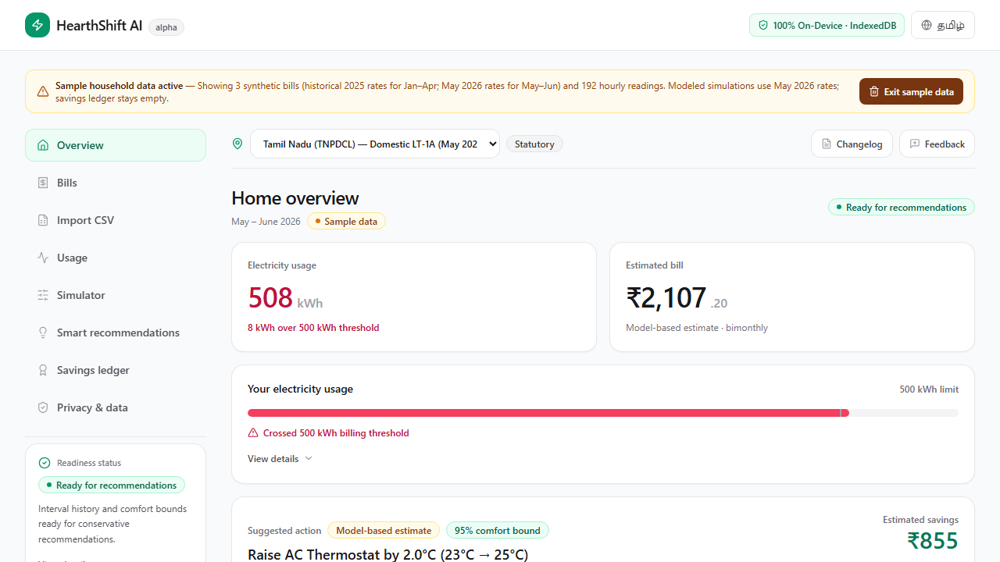
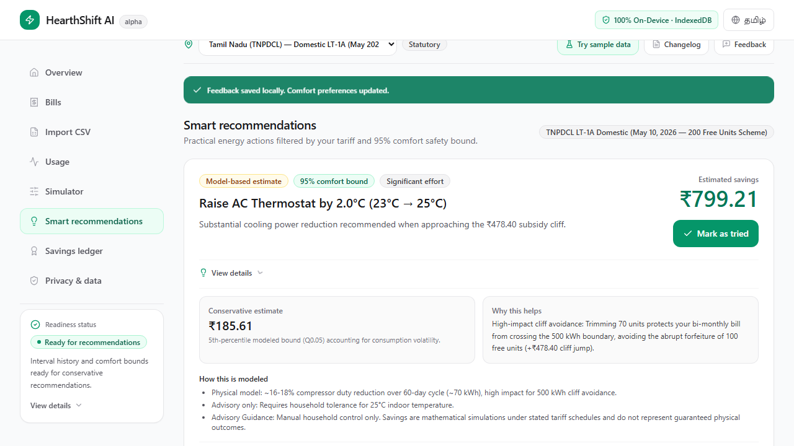
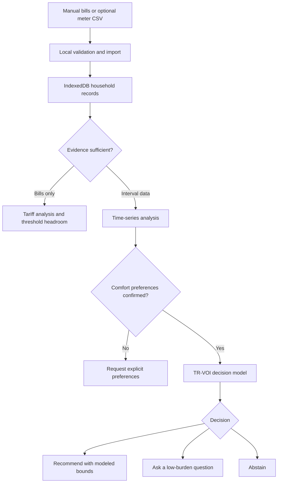

# HearthShift AI

**Local-first household electricity intelligence, built around evidence-aware decisions rather than invasive monitoring.**

[](https://github.com/Dinesh0401/HearthShift-AI/actions/workflows/ci.yml)


[**Live alpha**](https://hearthshift-ai.pages.dev/) · [**Architecture**](docs/ARCHITECTURE.md) · [**Run & contribute**](CONTRIBUTING.md) · [**Research evidence**](docs/research/STATISTICAL-EVALUATION-REPORT.md) · [**Release limitations**](docs/release/ALPHA-LIMITATIONS-AND-DISCLOSURES.md)

> **Status:** Deployed software alpha with completed automated verification and synthetic research experiments. No real-household usability study or measured electricity-savings trial has been completed. This is an advisory prototype—not a utility-certified bill calculator, an appliance controller, or a guaranteed savings product.

## Why this exists

A household should not need smart plugs in every room, a cloud account, or a long behavioral questionnaire just to understand its electricity bill and evaluate modest consumption changes.

HearthShift AI explores a narrower question:

> **How little household information is enough to make a useful electricity decision, while accounting for uncertainty, comfort, privacy, and the cost of asking questions?**

The current implementation is focused on **Tamil Nadu domestic LT I-A** tariff scenarios. It combines deterministic tariff calculations with a local decision engine that can **recommend**, **ask a targeted question**, or **abstain** when the available evidence does not support a recommendation.

## Product at a glance

| Household workflow | What the software provides |
| --- | --- |
| **Understand a bill** | Versioned tariff calculations, modeled charges, consumption history, and slab / subsidy threshold indicators. |
| **Import interval readings** | Local CSV validation and background parsing; unlocks time-series analysis only when appropriate data exists. |
| **Explore adjustments** | Counterfactual modeling of consumption reductions and selected load-shifting scenarios, with explicit assumptions. |
| **Get decision support** | TR-VOI evaluates modeled benefit, uncertain comfort, and the value of an additional question. It can abstain. |
| **Control personal information** | IndexedDB storage, full JSON export, batch rollback, and browser-local data erasure controls. |
| **Use English or Tamil** | Responsive interface with English/Tamil copy, visible synthetic demo labeling, and expandable technical disclosures. |

### Current interface

| Home overview — synthetic example | Recommendation details — modeled values |
| :---: | :---: |
|  |  |

To explore without entering your own bills, use [the live alpha](https://hearthshift-ai.pages.dev/) in a **fresh browser profile** and select **Load Safe Demo Dataset (Synthetic)**. **This replaces existing HearthShift records in that browser profile.** Sample figures and feedback are not real-world field evidence.

## How it works



All sensitive household calculations and persistence run **in the user's browser**. Cloudflare Pages serves the static application; the alpha does not send household records to a product backend or remote LLM. The Python research environment is **separate from the deployed client**.

**Architectural choices**

- **Deterministic money calculations:** Tariff computations use integer paise; uncertain savings are handled in a separate model layer.
- **Progressive capability gates:** Monthly/bi-monthly bills cannot be silently converted into fabricated hourly load curves.
- **Explicit comfort input:** Real users must confirm relevant preferences before comfort-dependent optimization is enabled. Demo constraints are labeled synthetic.
- **Conservative claims:** Savings have `simulated`, `user_reported`, `meter_observed`, or `measurement_verified` provenance. A modeled lower bound does not guarantee physical savings.
- **Local-first privacy:** Storage, export, and deletion remain browser-controlled. Downloaded JSON backups are **unencrypted**; shared-device and browser-extension risks still apply.

For the module-level rationale, dependency boundaries, data flow, and failure modes, read [`docs/ARCHITECTURE.md`](docs/ARCHITECTURE.md) and the [architecture decision records](docs/adr/README.md).

## Repository guide

```text
HearthShift-AI/
├── src/
│   ├── app/                 # Next.js app shell and dashboard orchestration
│   ├── components/          # UI: dashboard, forms, navigation, design primitives
│   ├── core/
│   │   ├── tariff/          # Deterministic tariff plans and billing arithmetic
│   │   ├── capabilities/    # Data-resolution and comfort eligibility gates
│   │   ├── ingestion/       # Manual bill and CSV validation
│   │   ├── simulation/      # Counterfactual scenario calculations
│   │   ├── optimization/    # TR-VOI, value of information, tariff moments
│   │   ├── recommendation/  # Decision orchestration
│   │   ├── storage/         # Reading imports and explicit comfort preferences
│   │   └── demo/            # Labeled synthetic household fixtures
│   ├── lib/db.ts            # Dexie / IndexedDB schema and data controls
│   ├── types/contracts.ts   # Shared domain contracts
│   ├── workers/             # Browser-side CSV worker
│   └── locales/             # English / Tamil strings
├── research/                # Independent Python simulator, baselines, experiments
├── tests/unit/              # Vitest domain / UI contract regression tests
├── tests/e2e/               # Playwright browser flows and screenshots
├── docs/                    # Architecture, ADRs, regulatory, research, pilot, release
├── scripts/                 # Static export verification and E2E support
└── .github/workflows/ci.yml # CI quality, build, and browser gates
```

**Where to start reading code:** [Capability policy](src/core/capabilities/policy.ts) → [Tariff calculator](src/core/tariff/calculator.ts) → [Recommendation engine](src/core/recommendation/engine.ts) → [TR-VOI implementation](src/core/optimization/tr-voi.ts) → [Browser database](src/lib/db.ts).

## Local development

**Prerequisites:** Node.js 20 (CI baseline), npm, and Python 3.12 if running research experiments.

```bash
git clone https://github.com/Dinesh0401/HearthShift-AI.git
cd HearthShift-AI
npm ci
npm run dev
```

Open `http://localhost:3000`. All local records are scoped to the browser profile.

```bash
# TypeScript / frontend verification
npm run type-check
npm run lint
npm test

# Production and static-export checks
npx playwright install chromium
npm run build
npm run test:e2e
npm run build:static
npm run verify:static
npm run test:e2e:static

# Separate Python research test suite
python -m venv .venv
# Activate: source .venv/bin/activate (macOS/Linux)
# or: .venv\Scripts\Activate.ps1 (Windows PowerShell)
python -m pip install -r research/requirements.txt
python -m pytest research/tests
```

See [`CONTRIBUTING.md`](CONTRIBUTING.md) for change boundaries, PR checks, and data-safety expectations.

## Engineering and research verification

**Verified alpha baseline:** merged UI and comfort-safety redesign at [`2a880ad`](https://github.com/Dinesh0401/HearthShift-AI/commit/2a880ad5b6cfa035ad9ddeaadcf5229ec0710602), with [successful GitHub Actions CI](https://github.com/Dinesh0401/HearthShift-AI/actions/runs/45952836450) on November 27, 2026.

| Test surface | Verified baseline |
| --- | --- |
| Python research / scoring tests | 65 passed |
| Vitest TypeScript unit / parity tests | 90 passed |
| Playwright Node production flow | 5 passed |
| Playwright static-export flow | 5 passed |
| Type checking, lint, static artifact / header verification | Passed |
| Production dependency audit | 0 reported vulnerabilities at verification time |

These checks validate defined software behaviors and threat-model test scenarios—not complete security assurance or empirical reduction in electricity consumption. Research reports use **synthetic households and explicit model assumptions**.

**Research trail:** [TR-VOI math](docs/research/TR-VOI-MATH-SPEC.md) · [Python/TypeScript numerical parity](docs/research/PHASE-3-PARITY-REPORT.md) · [Risk-matched baselines](docs/research/FAIR-BASELINE-COMPARISON.md) · [Calibration and robustness](docs/research/CALIBRATION-ROBUSTNESS.md) · [Scientific claim boundaries](docs/research/PUBLICATION-READINESS.md).

## Scope and limitations

- **Tariff scope:** Consumer-facing modeling targets Tamil Nadu domestic LT I-A. Generic flat / time-of-use references are illustrative. **May 10, 2026 mid-cycle proration is not confirmed**; relevant bill periods show a warning.
- **No measured savings claim:** Counterfactual and conservative values are conditional on modeled consumption, preferences, and tariff assumptions. Comfort risk estimates are **model-conditional**.
- **Not a full offline PWA:** A manifest is provided, but there is no offline Service Worker page cache; initial page loads and reloads require connectivity.
- **No hardware control:** The application does not operate plugs, heaters, AC units, or utility meters.
- **Privacy is not absolute:** Browser profile storage can be accessed by other users of that profile or sufficiently privileged extensions. JSON exports are unencrypted. The question-privacy penalty is **not differential privacy**.
- **Research governance:** Stage 1 usability study (planned N=5–10) has not started; supervisor/institutional authorization remains pending. A future Stage 2 effectiveness trial is separately proposed. No IPMVP Option C / ASHRAE Guideline 14 certification is claimed.

[Alpha disclosures](docs/release/ALPHA-LIMITATIONS-AND-DISCLOSURES.md) · [Regulatory traceability](docs/pilot/REGULATORY-SOURCE-TRACEABILITY.md) · [Oversight package](docs/pilot/PHASE-4C-B0-OVERSIGHT-SUBMISSION-PACKAGE.md) · [Field-pilot proposal](docs/pilot/FIELD-PILOT-PROTOCOL.md)

## Licensing

This public repository **does not currently contain a `LICENSE` file**. Public access does not grant permission to redistribute or relicense the code. The `"private": true` field in `package.json` controls npm publication, not the repository's visibility or legal licensing status.

---

Maintained as a research-backed engineering portfolio project. [Explore the product](https://hearthshift-ai.pages.dev/) · [Read the architecture](docs/ARCHITECTURE.md) · [Review the release checks](https://github.com/Dinesh0401/HearthShift-AI/actions/workflows/ci.yml)
