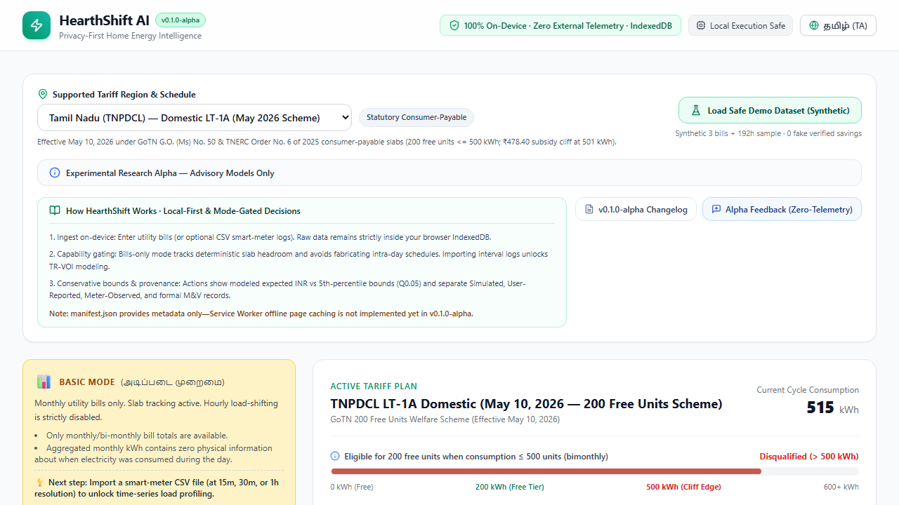
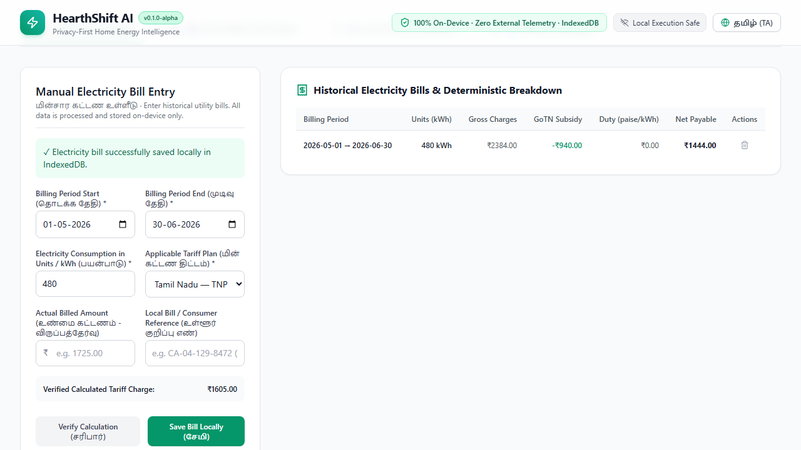
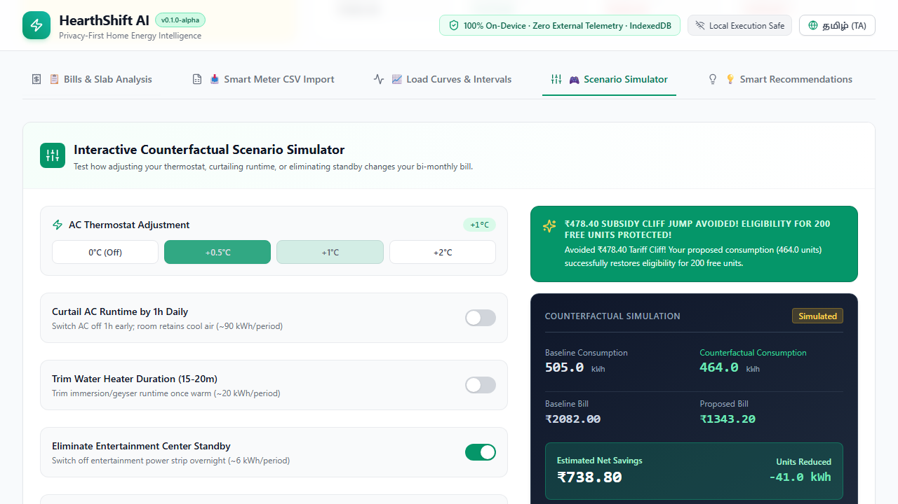
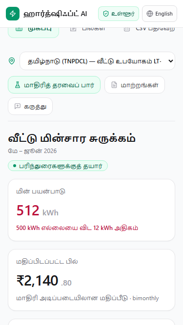

# HearthShift AI (`v0.1.0-alpha`)

### Local-First, Uncertainty-Aware Household Electricity Decision Prototype

[](https://www.typescriptlang.org/)
[](https://nextjs.org/)
[](docs/adr/ADR-001-local-first-architecture.md)
[](docs/security/PHASE-4A-SECURITY-PRIVACY-AUDIT.md)
[](https://github.com/Dinesh0401/HearthShift-AI/actions/runs/45670541360)

> **Deployed Public Alpha:** [`https://hearthshift-ai.pages.dev/`](https://hearthshift-ai.pages.dev/)  
> **GitHub Repository:** [`https://github.com/Dinesh0401/HearthShift-AI`](https://github.com/Dinesh0401/HearthShift-AI) · **Latest Verified Commit:** [`15523c8`](https://github.com/Dinesh0401/HearthShift-AI/commit/15523c8)  
> **Project Positioning:** *HearthShift AI is a deployed, research-backed AI Engineering alpha prototype (`v0.1.0-alpha`) with reproducible simulations, deterministic tariff calculators, and an oversight-ready Stage 1 study protocol. Zero real household trials have started yet—no empirical energy savings, utility billing certification, or IPMVP Option C verification are claimed.*

> **Core Research Problem:** *"What is the smallest amount of information necessary to help a household make a safer, clearer electricity decision—without harvesting interval telemetry to the cloud, triggering actuator hardware, or repeatedly disturbing occupants?"*

---

## 1. Current Project Completion Snapshot

| Workstream | Status | Evidence & Boundaries |
| :--- | :---: | :--- |
| **Client Web Application & Bilingual UI (`en` / `ta`)** | **Complete (`v0.1.0-alpha`)** | Static export on [`https://hearthshift-ai.pages.dev/`](https://hearthshift-ai.pages.dev/); `8` CSP/HSTS headers verified ([Phase 4B Report](docs/release/PHASE-4B-HOSTED-VERIFICATION-REPORT.md)) |
| **Deterministic Tariff & Scenario Engine** | **Complete (Software)** | Integer-paise calculator (`src/core/tariff/`), TNPDCL LT-1A slabs, May 10 boundary flags, non-double-counted cliff analysis |
| **TR-VOI Decision & Active Query Engine** | **Complete (Software & Sim)** | Closed-form Gaussian cliff integration in TypeScript & Python; evaluated across `7,500` synthetic decisions ([Statistical Report](docs/research/STATISTICAL-EVALUATION-REPORT.md)) |
| **Automated Tests & GitHub Actions CI** | **Passed (`15523c8`)** | `65/65` pytest, `86/86` Vitest, `tsc`, `eslint`, `5/5` prod/static/hosted Playwright specs ([CI Run `45670541360`](https://github.com/Dinesh0401/HearthShift-AI/actions/runs/45670541360)) |
| **Regulatory Archive & Scoring Pipeline** | **Complete (Pre-Study)** | SHA-256 archived TNERC orders ([Traceability Matrix](docs/pilot/REGULATORY-SOURCE-TRACEABILITY.md)); hardened scorer (`24/24` negative/unit tests) |
| **Research Oversight Package (`Phase 4C-B0`)** | **Submitted for Review** | Approval & pathway fields intentionally blank ([Oversight Package](docs/pilot/PHASE-4C-B0-OVERSIGHT-SUBMISSION-PACKAGE.md)) |
| **Real-User Usability Study (`N = 5–10`)** | **Pending Authorization** | `0` participants recruited; awaiting supervisor / institutional review determination ([Usability Protocol](docs/pilot/USABILITY-STUDY-PROTOCOL.md)) |
| **Powered Household Efficacy RCT & Manuscript** | **Not Started** | Blocked behind Stage 1 gates & separate Stage 2 ethics clearance ([Field Pilot Protocol](docs/pilot/FIELD-PILOT-PROTOCOL.md)) |

---

## 2. Why HearthShift AI? (Problem Statement & Approach)

Domestic electricity consumers under Tamil Nadu Power Distribution Corporation Limited (**TNPDCL**) Tariff **LT-1A** face non-convex bi-monthly slab jumps. Under Government of Tamil Nadu (**GoTN**) `G.O.(Ms) No. 50` (`10-05-2026`) and **TNERC Order No. 5 of 2026**, households using `<= 500 kWh` bi-monthly receive `200` free units (`₹1,570.00` modeled bill at `500 kWh`), whereas crossing to `501 kWh` reverts eligibility to `100` free units (`₹2,048.40`)—an abrupt **`+₹478.40` single-unit bill jump**.

Conventional home-energy apps often depend on cloud-connected smart plugs, upload raw consumption traces, pester occupants with static surveys, or let unconstrained LLMs hallucinate slab arithmetic near cliff boundaries. HearthShift AI addresses these failure modes strictly on-device:

1. **Threshold-Aware Robust Value of Information (`TR-VOI`):**
   - Evaluates exact closed-form piecewise bill expectations and variances across consumption uncertainty ($\sigma_X = 8.0\text{ kWh}$), eliminating numerical quadrature drift observed in 5-point Gauss-Hermite approximations ([Phase 3 Parity Report](docs/research/PHASE-3-PARITY-REPORT.md)).
   - Maintains Gaussian latent preference beliefs ($\boldsymbol{\mu}, \boldsymbol{\Sigma}$) across four appliance axes and gates suggestions with a one-sided comfort chance constraint ($P(D(a, \boldsymbol{\theta}) > D_{\max}) \le 0.05$, $z_\alpha = 1.645$) plus a conservative 5th-percentile welfare hurdle ($Q_{0.05}(U(a)) > c_{\min} = ₹30.00$).
   - Triggers an adaptive **Expected Value of Sample Information (`EVSI`)** clarifying question only when net value exceeds annoyance and privacy friction penalties ($\text{NetVOI}(q) = \text{EVSI}(q) - c_{\text{ask}} - c_{\text{priv}}(q) > 0$, $c_{\text{ask}} = ₹2.00$); otherwise recommends safely or **abstains**.
   - **Scope Demarcation:** Per [Publication Readiness](docs/research/PUBLICATION-READINESS.md), `c_priv` is a decision-theoretic annoyance friction, **not** differential privacy or cryptographic concealment, and TR-VOI uses a modeled linear comfort prior rather than claiming universal novelty in safe RL.
2. **Deterministic Integer-Paise Billing Engine (`src/core/tariff/`):**
   - Performs exact integer-paise arithmetic (`0` floating-point currency rounding drift) across TNPDCL LT-1A (`in-tnpdcl-lt1a-may2026`, `in-tnpdcl-lt1a-2025`, `in-tnpdcl-lt1a-2024` ref) plus illustrative India flat and pilot TOU references.
   - Surfaces a UI warning whenever a dated TNPDCL cycle crosses **`2026-05-10`**, because official utility mid-cycle proration rules are not established in archived TNERC orders.
3. **Progressive Capability Gating (`BASIC` → `INTERVAL` → `OPTIMIZATION_ELIGIBLE`):**
   - Enforced deterministically in [policy.ts](src/core/capabilities/policy.ts): when only bi-monthly bills exist (`BASIC`), time-series load charts and intra-day load-shifting optimization remain **strictly locked** rather than fabricated from monthly totals. Even when unlocked via CSV import (`>= 7` days / `>= 168` readings + constraints), pure time-shifting evaluates to **`₹0.00`** under non-TOU flat/tiered TNPDCL LT-1A tariffs.
4. **Client-Side Execution & Zero Cloud Telemetry:**
   - Zero Next.js `/api/` routes, zero Server Actions, zero remote databases, zero remote LLM calls (`ADR-004`), and zero third-party analytics scripts.

---

## 3. Practical Household Use Cases

- **Track Headroom Before the `500 kWh` Cliff (`BASIC` Mode):** Enter bi-monthly bill periods and kWh locally to view itemized gross charges, GoTN base/welfare subsidies, net payable amounts, and remaining kWh before the `₹478.40` cliff—while checking any cycle crossing `2026-05-10` with an explicit caution badge.
- **Measure Overnight Standby Drain Without Smart Plugs (`INTERVAL` Mode):** Import smart-meter or plug-logger CSV files (`15m`/`30m`/`1h` timestamps, up to `25 MB` / `500,000` rows parsed off-thread via Web Worker) to inspect quiet-hour (`01:00–05:00`) standby baseload without invented curves.
- **Simulate Realistic Trade-offs Manually (`OPTIMIZATION_ELIGIBLE` Mode):** Toggle AC setpoint (`+0.5°C` to `+2.0°C`), AC runtime trim, water heater duration trim, standby shutoff, or laundry time-shifting—observing non-additive cliff bonuses (`₹864.80 = ₹386.40` volumetric + `₹478.40` preserved subsidy) and conservative $Q_{0.05}$ estimates alongside comfort assumptions.
- **Explore Safely via Demo Mode (`v0.1.0-alpha`):** Clicking **Load Safe Demo Dataset (Synthetic)** loads `3` historical synthetic bills (`Jan–Feb 2026`: `445 kWh` → `₹1,458.50` and `Mar–Apr 2026`: `492 kWh` → `₹1,754.60` under `in-tnpdcl-lt1a-2025`; `May–Jun 2026`: `508 kWh` → `₹2,107.20` under `in-tnpdcl-lt1a-may2026` with boundary indicator) plus `192` hourly readings while keeping the **Savings Ledger strictly empty (`₹0.00`)** and evaluating counterfactuals against the active May 2026 scheme.

---

## 4. Interface Showcase (Captured Live & Verification Screenshots)

| Surface | Representative Screenshot | Verified Behavior Shown |
| :--- | :---: | :--- |
| **Alpha Control Strip & Capability Gating** |  | Region/tariff selector, Safe Demo loader, *How HearthShift Works* non-offline note, bilingual EN/TA toggle, and `BASIC MODE` lock explanation |
| **Manual Bill Entry & May 10 Boundary Flag** |  | Client-side TNPDCL itemized breakdown (`Gross`, `GoTN Subsidy`, `Net Payable`) plus explicit mid-cycle May 10, 2026 uncertainty notice |
| **Counterfactual Cliff Simulator** |  | `505.0 → 444.0 kWh` counterfactual avoiding the `+₹478.40` cliff (`₹864.80` total modeled delta, `Simulated` badge) |
| **TR-VOI Decision & Uncertainty Bounds** |  | `SPARE-HEM Decision-Aware Recommendations` surfacing `Modeled Estimate`, `95% Modeled Comfort Bound`, and `Tried It!` provenance controls |
| **Mobile (`375×667`) Tamil (`தமிழ்`) UI** |  | Responsive mobile navigation, full Tamil localization, and `OPTIMIZATION ELIGIBLE` status after `8.0` days of interval data |

---

## 5. Technical Architecture & Reproducible Commands

### Technology Stack
- **Web App (`src/`):** Next.js `16.4.6` (`next build --webpack`, static export `output: 'export'`), React `18.3.1`, TypeScript `5.6.3`, Tailwind CSS `3.4.15`, Recharts `2.13.3`, Zod `4.6.7`, Dexie `4.0.8` (`IndexedDB` `HearthShiftDB`), Lucide Icons, and `src/workers/csv-parser.worker.ts` (pure JS/TS, zero Wasm).
- **Research & Scoring (`research/`):** Python `3.12`, NumPy `>= 1.26.0`, SciPy `>= 1.12.0`, Pandas `>= 2.2.0`, Pytest `>= 8.0.0`.
- **Verification & Edge Security:** Vitest `2.1.x`, Playwright `1.49.0` Chromium, ESLint `8.57.1`, GitHub Actions CI ([`.github/workflows/ci.yml`](.github/workflows/ci.yml)), Cloudflare Pages + [`public/_headers`](public/_headers).

### Repository Layout
```text
HearthShift-AI/
├── .github/workflows/ci.yml    # Full TypeScript, Python, production & static E2E CI pipeline
├── public/                     # Static manifest.json, icon.svg, Cloudflare Pages _headers
├── scripts/                    # Static export build & security verification scripts
├── src/
│   ├── app/                    # Next.js App Router pages & layout (no /api/ endpoints)
│   ├── components/             # Dashboard, ingestion, simulator, alpha modals, savings ledger
│   ├── core/                   # Tariff calculator, demo loader, capability policy, TR-VOI engine
│   ├── lib/                    # Dexie IndexedDB schema & atomic wipe / JSON export helpers
│   ├── locales/                # Bilingual English ('en') & Tamil ('ta') dictionaries
│   └── workers/                # Background Web Worker for CSV parsing
├── research/
│   ├── algorithms/ baselines/ simulator/   # Python SPARE-HEM / TR-VOI & tariff parity harness
│   ├── experiments/            # Power analysis, synthetic eval, hardened Stage 1 usability scorer
│   ├── fixtures/ results/      # Synthetic benchmark & power-analysis JSON fixtures
│   └── tests/                  # 65 Pytest unit, parity, invariance & scorer validation tests
├── tests/                      # 86 Vitest unit/parity tests & 5 Playwright E2E specs + screenshots
└── docs/                       # PRDs, ADRs, Threat Model, Research Specs, Release & Pilot Kits
```

### Reproducible Local Setup & Full Verification
```bash
# 1. Install JS dependencies
npm ci

# 2. Set up Python research environment (Windows PowerShell: research\.venv\Scripts\python.exe)
python -m venv research/.venv
research/.venv/Scripts/python -m pip install "numpy>=1.26.0" "scipy>=1.12.0" "pandas>=2.2.0" "pytest>=8.0.0"

# 3. Run code quality, security audit, unit/parity & Python suites
npm audit --omit=dev
npm run type-check
npm run lint
npm test -- --run                 # 86/86 Vitest tests across 10 files
pytest research/tests             # 65/65 Python tests (set OPENBLAS_NUM_THREADS=1 on low-pagefile Windows)

# 4. Build & test Next.js production + Cloudflare static export bundles
npm run build
npm run test:e2e                  # 5/5 Playwright E2E specs against production server
npm run build:static
npm run verify:static             # Audits 37 files in out/, 8 headers, 0 leaked secrets
npm run test:e2e:static           # 5/5 Playwright E2E specs against compiled out/ bundle

# 5. Optional: verify the live Cloudflare Pages origin directly
E2E_BASE_URL=https://hearthshift-ai.pages.dev npx playwright test
```

---

## 6. Verification Evidence, Research Documentation & Oversight Index

Every deliverable uses GitHub-relative repository links cleanly:

| Category | Key Document / Report | Verified Content |
| :--- | :--- | :--- |
| **Oversight & Human Study Gate** | [`PHASE-4C-B0-OVERSIGHT-SUBMISSION-PACKAGE.md`](docs/pilot/PHASE-4C-B0-OVERSIGHT-SUBMISSION-PACKAGE.md) | 10-part ethics/supervisor submission packet (EN/TA consent forms, risk assessment, 30-day purge & withdrawal SOP, mid-cycle tariff review, **blank** approval block) |
| **Stage 1 Protocol & Kit** | [`USABILITY-STUDY-PROTOCOL.md`](docs/pilot/USABILITY-STUDY-PROTOCOL.md) · [`PHASE-4C-USABILITY-STUDY-EXECUTION-KIT.md`](docs/pilot/PHASE-4C-USABILITY-STUDY-EXECUTION-KIT.md) | $N = 5\text{--}10$ 10-step moderation script, dual-stage safety rubric (`SAF-1`–`SAF-4`), Brooke SUS, SEQ, and Question Burden probes |
| **Scorer & Synthetic Dry Run** | [`stage1_usability_scoring.py`](research/experiments/stage1_usability_scoring.py) · [`PHASE-4C-SYNTHETIC-SAMPLE-REPORT.md`](docs/pilot/PHASE-4C-SYNTHETIC-SAMPLE-REPORT.md) | Defensive validation (`24/24` tests), participant-level vs. repeated-measures separation, explicit `N/A` denominators |
| **Regulatory Traceability** | [`REGULATORY-SOURCE-TRACEABILITY.md`](docs/pilot/REGULATORY-SOURCE-TRACEABILITY.md) · [`regulatory-archive/INDEX.md`](docs/pilot/regulatory-archive/INDEX.md) | SHA-256 archived TNERC Orders (`Order 6/2025`, `Order 4/2026`, `Order 5/2026`, `Order 6/2026`) and mid-cycle disclaimers |
| **Hosted Production Audit** | [`PHASE-4B-HOSTED-VERIFICATION-REPORT.md`](docs/release/PHASE-4B-HOSTED-VERIFICATION-REPORT.md) · [`ALPHA-LIMITATIONS-AND-DISCLOSURES.md`](docs/release/ALPHA-LIMITATIONS-AND-DISCLOSURES.md) | Live HTTPS verification, all `8/8` response security headers, and mandatory public safety boundaries |
| **Security & Threat Model** | [`PHASE-4A-SECURITY-PRIVACY-AUDIT.md`](docs/security/PHASE-4A-SECURITY-PRIVACY-AUDIT.md) · [`THREAT-MODEL.md`](docs/threat-model/THREAT-MODEL.md) | STRIDE/LINDDUN threat analysis, strict CSP, zero same-origin/external telemetry checks |
| **Stage 2 Power & M&V Gaps** | [`FIELD-PILOT-PROTOCOL.md`](docs/pilot/FIELD-PILOT-PROTOCOL.md) · [`MV-METHODOLOGY-REVIEW.md`](docs/pilot/MV-METHODOLOGY-REVIEW.md) · [`power_analysis.py`](research/experiments/power_analysis.py) | Stage 2 RCT sizing ($N = 152\text{--}160$ / $140\text{--}150$ cliff-enriched) and ASHRAE 14 / IPMVP Option C non-certification gap review |
| **Architecture & Specs** | [`PRD.md`](docs/prd/PRD.md) · [`DATA-CONTRACTS.md`](docs/prd/DATA-CONTRACTS.md) · [`DATABASE-SCHEMA.md`](docs/prd/DATABASE-SCHEMA.md) · [`ADRs`](docs/adr/README.md) · [`CHANGELOG.md`](CHANGELOG.md) | Canonical domain contracts, Dexie `IndexedDB` tables, ADRs `001–006`, release notes |
| **Synthetic Math & Sims** | [`RESEARCH-SPEC.md`](docs/research/RESEARCH-SPEC.md) · [`PHASE-3-PARITY-REPORT.md`](docs/research/PHASE-3-PARITY-REPORT.md) · [`STATISTICAL-EVALUATION-REPORT.md`](docs/research/STATISTICAL-EVALUATION-REPORT.md) · [`PUBLICATION-READINESS.md`](docs/research/PUBLICATION-READINESS.md) | Python/TS parity, quadrature bounds, `7,500`-decision simulation benchmark, and Tier 1/2/3 claim hygiene |

---

## 7. Known Limitations, Privacy Considerations & Validation Roadmap

### Explicit Technical & Scientific Limitations
- **Requires Network Load (Not Offline-Cached Yet):** Although [`public/manifest.json`](public/manifest.json) provides basic web-app metadata and open sessions execute strictly locally in browser `IndexedDB`, **`v0.1.0-alpha` does NOT ship an offline Service Worker cache**—loading or reloading [`https://hearthshift-ai.pages.dev/`](https://hearthshift-ai.pages.dev/) requires network access.
- **Browser-Profile Storage & Local Risk Surface:** Entered bills and interval CSVs persist across tab closes and restarts inside the browser profile's `IndexedDB` until wiped via **Delete All My Data**, Private/Incognito closure, or disk-pressure eviction. Local JSON backups (`exportAllUserData()`) are **unencrypted plaintext**, untrusted browser extensions (`<all_urls>`) can inspect DOM/storage, and free-text comments in the zero-telemetry Feedback modal require **manual PII review** before external copying or sharing.
- **No Hardware Actuation & Health Primacy:** Zero integrations with smart plugs, AC controllers, water heaters, or utility meters exist. Users must manually implement any chosen adjustment, prioritize comfort/safety during heatwaves or occupant illness, and never tamper with internal water heater thermal cutouts.
- **No Billing Certification or M&V Certification:** Calculations implement documented Tamil Nadu consumer-payable LT-1A models rather than certified TNERC/TNPDCL billing engines; `prorateBillAcrossTariffVersions()` remains intentionally unactivated in UI code, cycles crossing `2026-05-10` display uncertainty notices, standalone `G.O.(Ms) No. 50` / pre-2025 order PDFs remain unarchived, and IPMVP Option C / ASHRAE Guideline 14 certification is **not** claimed.
- **Simulated vs. Empirical Scope:** Simulation numbers (e.g., `0.441` normalized regret and `2.4%` comfort violations across `7,500` synthetic runs) validate mathematical consistency under stylized Gaussian priors—not human electricity savings.

### Human-Validation & Publication Roadmap (`Pending Approval`)
1. **Oversight Review (`Phase 4C-B0` — Current Gate):** Present [`PHASE-4C-B0-OVERSIGHT-SUBMISSION-PACKAGE.md`](docs/pilot/PHASE-4C-B0-OVERSIGHT-SUBMISSION-PACKAGE.md) to academic supervisor / institutional ethics committee for written pathway/exemption determination and designated `4C_Stage1_Data/` custodian approval.
2. **Stage 1 Usability & Safety Comprehension Study (`Phase 4C-B`, $N = 5\text{--}10$):** Execute bilingual (`en`/`ta`) moderated sessions only after authorization; score task completions, Brooke SUS, Question Burden, and dual-stage first-attempt safety checks (`SAF-1`–`SAF-4`) via [`stage1_usability_scoring.py`](research/experiments/stage1_usability_scoring.py). Complete any required UI copy remediation before RCT lock.
3. **Stage 2 Powered RCT & Empirical Manuscript (`Future`):** Conditional on passing all Stage 1 exit gates and obtaining separate ethics approval, evaluate real-household kWh and cliff-avoidance outcomes under [`FIELD-PILOT-PROTOCOL.md`](docs/pilot/FIELD-PILOT-PROTOCOL.md) and publish results transparently with full limitations.

---

> **License / Reuse Notice:** Repository source and research protocols are provided for academic review and reproducible research verification; no separate `LICENSE` file is bundled in this alpha tag (`private: true` in `package.json`).
