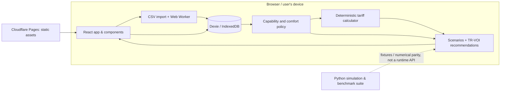
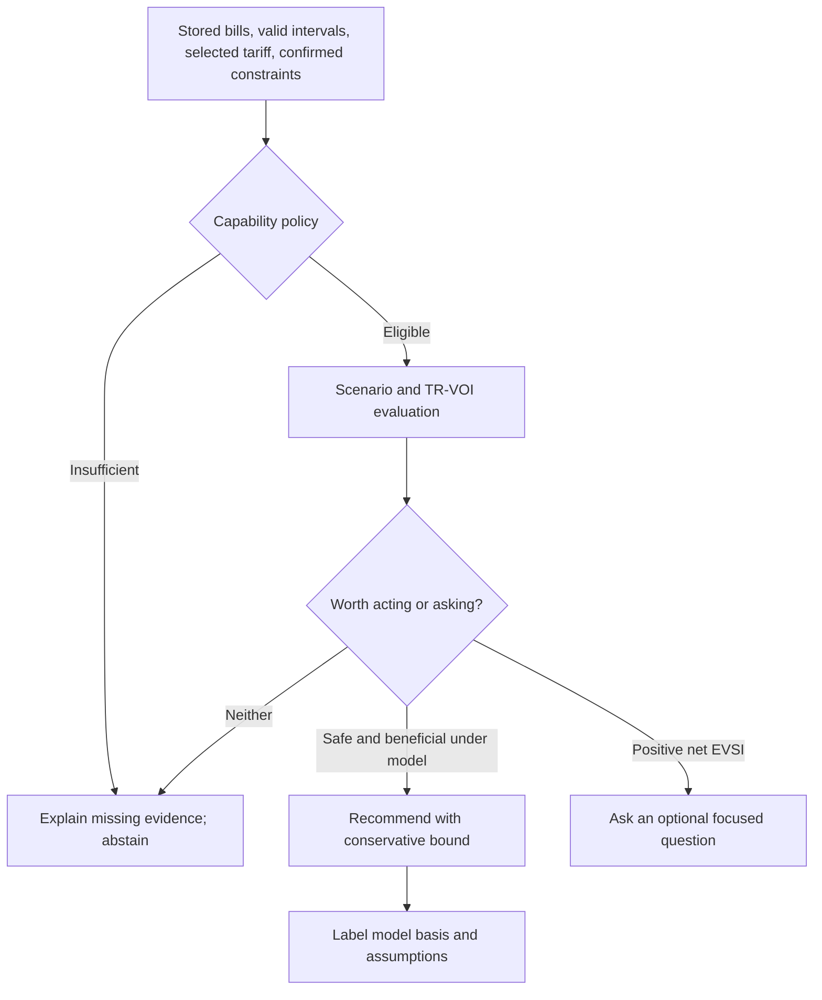

# Engineering architecture

**HearthShift AI · v0.1.0-alpha · Architecture reference**

This document is an entry point for engineers reviewing the deployed TypeScript application and its independent Python research environment. It describes the **implemented** system; hypotheses and future field-study plans are linked separately.

## 1. System boundary

The product is a browser-executed Next.js / React application built for static hosting on Cloudflare Pages. It does **not** expose a household-data API, operate appliances, or call a remote LLM. Device data and user preferences are persisted locally in IndexedDB through Dexie.

**Trust boundary:** The CDN provides JavaScript, CSS, HTML, and HTTP security headers. Once loaded, user-entered bills, imported readings, and model computations are browser-local in tested product workflows. A browser extension, shared profile, malicious script, or exported JSON file remains a real privacy surface; local-first is not a cryptographic guarantee.

## 2. Code ownership and module map

| Location | Responsibility | Entry point |
| --- | --- | --- |
| [`src/app/`](../src/app/page.tsx) | Dashboard composition, navigation, cross-component refresh state | `page.tsx` |
| [`src/components/ui/`](../src/components/ui/Card.tsx) | Reusable card, badge, disclosure, loading and empty-state primitives | `Card.tsx` |
| [`src/components/dashboard/`](../src/components/dashboard/HomeOverview.tsx) | Household overview, recommendations, modeled billing, ledger, privacy surfaces | `HomeOverview.tsx` |
| [`src/components/ingestion/`](../src/components/ingestion/ManualBillForm.tsx) | User input, CSV import, and feature readiness presentation | `ManualBillForm.tsx` |
| [`src/core/tariff/`](../src/core/tariff/calculator.ts) | Pure billing calculation and versioned tariff definitions | `calculator.ts` |
| [`src/core/capabilities/`](../src/core/capabilities/policy.ts) | `BASIC` / `INTERVAL` / `OPTIMIZATION_ELIGIBLE` decision policy | `policy.ts` |
| [`src/core/ingestion/`](../src/core/ingestion/csv-parser.ts) | Input normalization, CSV validation, manual bill validation | `csv-parser.ts` |
| [`src/core/simulation/`](../src/core/simulation/scenario-engine.ts) | Counterfactual modeled reductions and shifts | `scenario-engine.ts` |
| [`src/core/optimization/`](../src/core/optimization/tr-voi.ts) | Action catalog, domain types, analytical tariff moments and TR-VOI policy | `tr-voi.ts` |
| [`src/core/recommendation/`](../src/core/recommendation/engine.ts) | Model output and recommendation orchestration | `engine.ts` |
| [`src/core/storage/`](../src/core/storage/household-preferences.ts) | Confirmed user preferences and chunked reading imports | `household-preferences.ts` |
| [`src/lib/db.ts`](../src/lib/db.ts) | IndexedDB schema, browser-local erasure and JSON backup | `db.ts` |
| [`src/types/contracts.ts`](../src/types/contracts.ts) | Cross-feature TypeScript domain contracts | `contracts.ts` |
| [`src/workers/`](../src/workers/csv-parser.worker.ts) | Off-main-thread CSV work | `csv-parser.worker.ts` |
| [`src/locales/`](../src/locales/i18n.tsx) | English/Tamil UI wording and selection | `i18n.tsx` |
| [`research/`](../research/pyproject.toml) | Python simulation, baselines, synthetic experiments, scoring and parity | `research/pyproject.toml` |
| [`tests/`](../tests/unit/tr-voi.test.ts) | Unit/parity tests and Playwright browser workflows | `tests/unit/`, `tests/e2e/` |

**Dependency intent:** Components present information and invoke domain/storage APIs; `src/core` houses the algorithms and rule logic; `src/lib` implements client persistence. The research package is a separate experimental environment, **not** an API server and not a requirement for a visitor to run the UI.

## 3. Data and decision flows

### A. Manual bill entry

1. A user supplies a billing period, units, and a selected tariff.
2. [`manual-bill.ts`](../src/core/ingestion/manual-bill.ts) validates the input.
3. [`calculator.ts`](../src/core/tariff/calculator.ts) computes the modeled bill with deterministic integer-paise arithmetic.
4. Browser records are saved through Dexie and displayed in the bill-history and threshold views.
5. If a cycle straddles May 10, 2026, the UI must preserve the explicit mid-cycle tariff uncertainty notice.

**Non-goal:** An aggregated bill does **not** reveal intraday load curves or appliance attribution. `BASIC` mode must not invent them.

### B. Optional interval data

1. CSV is validated locally with the ingestion parser and browser Web Worker.
2. Accepted readings are stored with import-batch identifiers, permitting rollback.
3. The capability policy enables interval visualizations only when readings exist and are suitable.
4. Comfort-dependent optimization requires adequate coverage **and explicitly saved user constraints**.

The key invariant is implemented in [`household-preferences.ts`](../src/core/storage/household-preferences.ts): **the application does not interpret the presence of 168 readings as user confirmation of comfort tolerance**. The synthetic demo supplies separately labeled demo constraints.

### C. Recommendations

[`action-catalog.ts`](../src/core/optimization/action-catalog.ts) defines candidates. [`piecewise-moments.ts`](../src/core/optimization/piecewise-moments.ts) isolates numerical integration. [`tr-voi.ts`](../src/core/optimization/tr-voi.ts) evaluates actions and active questioning. [`engine.ts`](../src/core/recommendation/engine.ts) integrates the domain decision with application-specific presentation contracts.

The central decision is **recommend / ask / abstain**. Expected utility, comfort chance constraints, and lower quantiles are conditional on the selected mathematical model. They do not establish observed household savings or guarantee comfort in all physical conditions.

## 4. Storage, privacy and provenance

[`HearthShiftDB`](../src/lib/db.ts) defines ten tables: `meta`, `tariffs`, `bills`, `readings`, `preferences`, `recommendations`, `feedback`, `savings`, `scenarios` and `questions`.

- **Local persistence:** Browser IndexedDB; no product server-side household database.
- **Export:** A read transaction covers all ten tables, including complete readings. Exported JSON is **unencrypted** and may be large.
- **Erasure:** User tables are cleared, while public tariff data is preserved.
- **Demo mode:** Synthetic bills and readings are intentionally distinguishable from field measurements. Loading the synthetic dataset can replace existing profile data.
- **Savings provenance:** Preserve distinctions between model simulations, user reports, meter observations, and independently verified measurement records. A tag is not a certification.

See [data contracts](prd/DATA-CONTRACTS.md), [database schema](prd/DATABASE-SCHEMA.md), [threat model](threat-model/THREAT-MODEL.md), and [security audit](security/PHASE-4A-SECURITY-PRIVACY-AUDIT.md).

## 5. Verification strategy

| Property | Evidence |
| --- | --- |
| Tariff arithmetic and threshold behavior | [Unit tests](../tests/unit/billing-calculator.test.ts), [tariff research parity](../research/tests/test_tariff_equivalence.py) |
| Capability and comfort gates | [Capability tests](../tests/unit/capability-policy.test.ts), [comfort opt-in tests](../tests/unit/comfort-constraints-policy.test.ts) |
| Ingestion and privacy | [CSV tests](../tests/unit/csv-parser.test.ts), [full export test](../tests/unit/db-export.test.ts) |
| TR-VOI math and Python parity | [TR-VOI tests](../tests/unit/tr-voi.test.ts), [parity fixtures](../tests/fixtures/cross_language_parity_fixtures.json), [research parity](research/PHASE-3-PARITY-REPORT.md) |
| End-user flows and responsive behavior | [Playwright specs](../tests/e2e/phase4b-alpha-presentation.spec.ts) |
| Production build, audit, static bundle and browser checks | [CI workflow](../.github/workflows/ci.yml), [verified run](https://github.com/Dinesh0401/HearthShift-AI/actions/runs/45952836450) |
| Synthetic research effectiveness under assumptions | [Statistical report](research/STATISTICAL-EVALUATION-REPORT.md), [fair comparison](research/FAIR-BASELINE-COMPARISON.md) |

The project has two kinds of evidence, which must not be conflated:

1. **Engineering verification:** TypeScript, Python, browser E2E, numerical parity, and deployed asset checks.
2. **Scientific validation:** Synthetic studies are documented; actual consenting household studies and measured energy outcomes are **pending**.

## 6. Delivery and design decisions

The app has a Next.js production build and an opt-in static export for Cloudflare Pages (`npm run build:static`, output `out/`). Response headers are described in [deployment runbook](deployment/PRODUCTION-DEPLOYMENT-GUIDE.md), with current public-alpha disclosures in [release limitations](release/ALPHA-LIMITATIONS-AND-DISCLOSURES.md).

**Known compromises:** No offline Service Worker cache; no utility certification; no hardware actuation; no remote telemetry collection in tested product workflows; model-dependent risk and savings; browser-profile and exported-file security responsibilities.

The larger reasons for local-first execution, deterministic billing, and progressive resolution gating are captured in the [ADR index](adr/README.md). Do not change these invariants without updating their tests and associated claims.
