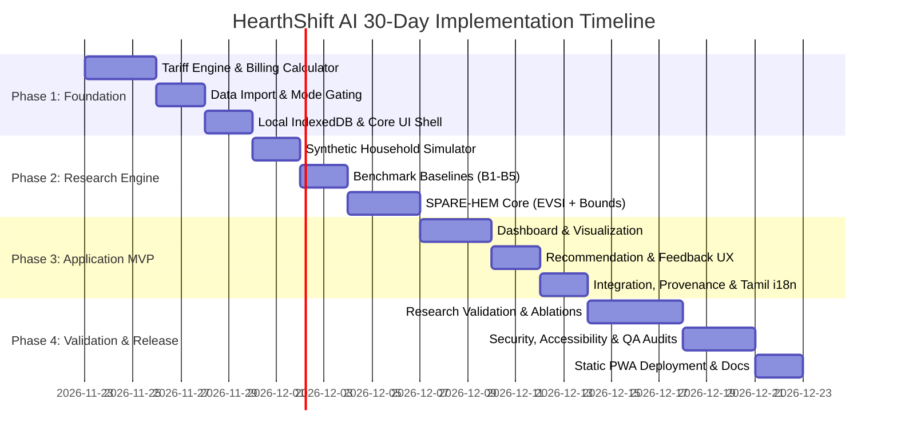

# 30-Day Milestone Implementation Plan
## HearthShift AI — From Mathematical Foundations to Validated PWA

**Document Status:** Approved Engineering Roadmap  
**Target Completion:** 30 Days across 4 Sequential Phases  
**Methodology:** Milestone-Gated Test-Driven Development (TDD)  

---

## 1. Roadmap Overview & Timeline

---

## 2. Phase 1: Foundation (Days 1–7)
*Objective: Build an auditable, deterministic billing engine, local storage layer, and mode-gated ingestion pipeline with zero network transmission.*

### Milestone 1.1: Deterministic Tariff & Billing Engine (Days 1–3)
* **Tasks:**
  * Implement `src/core/tariff/tariff-types.ts` and runtime schema validators.
  * Build deterministic billing calculators supporting:
    1. Flat-rate tariffs with fixed monthly charges.
    2. Telescopic and non-telescopic tiered slab tariffs (e.g. TANGEDCO LT-1A).
    3. Multi-period Time-of-Use (TOU) tariffs.
    4. Hybrid tiered-TOU tariffs.
  * Create verified regulatory test fixtures (`tests/fixtures/tariffs/`).
  * Codify 25+ automated unit tests in Vitest covering slab boundary transitions, pro-rating, zero usage, and invalid inputs.
* **Deliverable:** 100% deterministic, standalone billing calculator passing all unit tests.

### Milestone 1.2: Data Import & Capability Mode Gating (Days 4–5)
* **Tasks:**
  * Build manual monthly bill entry form with strict validation (dates, non-negative kWh).
  * Build client-side streaming CSV parser for interval data (Low Carbon London, REFIT, generic 2-column format) running in a Web Worker.
  * Implement automatic analysis mode classification (`basic` vs `detailed`) with capability guards.
  * Add line-by-line CSV validation error reporting for malformed rows.
* **Deliverable:** Client-side ingestion pipeline that correctly classifies mode and handles invalid inputs gracefully.

### Milestone 1.3: Local IndexedDB Persistence & UI Skeleton (Days 6–7)
* **Tasks:**
  * Implement Dexie.js database schema (`src/lib/db.ts`) with typed stores and indices.
  * Implement atomic `deleteAllUserData()` and `exportAllUserData()` privacy functions.
  * Scaffold Next.js / Tailwind application layout with accessible navigation shell.
  * Configure i18n infrastructure supporting English (`en`) and Tamil (`ta`).
* **Deliverable:** Working PWA skeleton with persistent local storage, verified offline capability, and zero external network requests.

---

## 3. Phase 2: Research Engine (Days 8–14)
*Objective: Implement the synthetic household simulator, comparative baselines, and the SPARE-HEM decision algorithm.*

### Milestone 2.1: Household Simulation Environment (Days 8–9)
* **Tasks:**
  * Develop Python simulation package (`research/simulation/`).
  * Model 4 household archetypes (Chennai family, single professional, retired couple, student flat).
  * Implement appliance load generators (inverter AC, ceiling fans, washing machine, refrigerator).
  * Implement stochastic agent response model with Gumbel noise.
* **Deliverable:** Deterministic synthetic cohort generator exporting reproducible datasets.

### Milestone 2.2: Benchmark Baselines (Days 10–11)
* **Tasks:**
  * Baseline 1 (B1): Static rule-based efficiency heuristics.
  * Baseline 2 (B2): Price-only cost minimizer ($\lambda = 0$).
  * Baseline 3 (B3): Static 10-question questionnaire + schedule optimizer.
  * Baseline 4 (B4): Active uncertainty sampling (LICA-style parameter entropy reduction).
  * Baseline 5 (B5): Full-information oracle with true latent preferences $\boldsymbol{\theta}^*$.
* **Deliverable:** Benchmarking test harness computing decision loss, question count, and regret across baselines.

### Milestone 2.3: SPARE-HEM Core Implementation (Days 12–14)
* **Tasks:**
  * Implement Bayesian preference model with recursive updates from sparse feedback $y \in \{-1, 0, +1\}$.
  * Implement Expected Value of Sample Information ($\text{EVSI}$) calculation for candidate queries.
  * Implement burden and privacy penalized question selection: $q^* = \arg\max [\text{EVSI}(q) - \alpha B(q) - \beta P(q)]$.
  * Implement conservative savings lower bound calculator $S_{\text{lower}} = Q_\alpha(S)$.
  * Implement tri-state decision gate: `recommend`, `ask_question`, or `abstain`.
* **Deliverable:** Fully functional SPARE-HEM algorithmic engine validated on synthetic cohorts.

---

## 4. Phase 3: Application MVP (Days 15–21)
*Objective: Deliver a responsive, multilingual, accessible web interface connecting on-device intelligence to user workflows.*

### Milestone 3.1: Visual Dashboard & Scenario Simulator (Days 15–17)
* **Tasks:**
  * Interactive expenditure and bill history charts using Recharts.
  * Slab headroom visualizer (units remaining before entering higher tariff slab).
  * Time-series load visualizer (strictly locked to `detailed` mode; hidden in `basic` mode).
  * Interactive counterfactual scenario simulator (e.g. shift laundry from 7 PM to 7 AM, adjust AC setpoint).
* **Deliverable:** High-performance dashboard with strict capability-gated visualizations.

### Milestone 3.2: Recommendation Cards & Adaptive Interaction (Days 18–19)
* **Tasks:**
  * Recommendation cards displaying:
    * Action title and plain-language explanation.
    * Conservative savings lower bound with confidence badge.
    * Explicit assumption checklist.
    * Savings basis provenance badge (🟡 `Simulated`, 🔵 `User Reported`, 🟢 `Meter Verified`).
  * 1-click feedback buttons (`Useful`, `Impractical`, `Tried it`).
  * Single-question adaptive query modal (rendered only when EVSI exceeds hurdle).
* **Deliverable:** Intuitive recommendation interface respecting the household's time and privacy.

### Milestone 3.3: Savings Evidence Tracker & Tamil Localization (Days 20–21)
* **Tasks:**
  * Savings ledger tracking cumulative simulated vs verified savings over time.
  * Complete Tamil (தமிழ்) translation for all UI strings, tariff labels, and recommendation explanations.
  * Responsive mobile optimization (360px width support, touch targets $\ge 48\text{px}$).
* **Deliverable:** Fully bilingual, production-ready MVP application.

---

## 5. Phase 4: Validation, Audits & Deployment (Days 22–30)
*Objective: Execute scientific benchmark evaluations, perform security and accessibility audits, and release public static PWA.*

### Milestone 4.1: Research Experiments & Ablation Matrix (Days 22–25)
* **Tasks:**
  * Run 1,000 synthetic household trials comparing SPARE-HEM against B1–B5.
  * Execute 4 ablation experiments:
    * (A1) EVSI vs Entropy-only questioning.
    * (A2) Risk penalty ablation ($\mu = 0$).
    * (A3) Privacy penalty ablation ($\beta = 0$).
    * (A4) Conservative lower bound vs point-estimate savings.
  * Generate statistical calibration plots (coverage of nominal 95% intervals).
  * Compile formal research report (`research/results/evaluation_report.md`).
* **Deliverable:** Reproducible experiment scripts, benchmark tables, and calibration curves.

### Milestone 4.2: Security, Privacy & Accessibility Audits (Days 26–28)
* **Tasks:**
  * Automated network traffic audit via Playwright asserting zero outbound data transmission.
  * WCAG 2.1 Level AA accessibility audit using `axe-core`.
  * Mobile performance profiling (Lighthouse score $\ge 90$ for Performance, Accessibility, Best Practices).
  * Cross-browser verification (Chrome, Firefox, Safari on iOS/macOS/Windows/Android).
* **Deliverable:** Comprehensive audit reports verifying zero privacy leakage and full compliance.

### Milestone 4.3: Deployment & Public Release (Days 29–30)
* **Tasks:**
  * Deploy static PWA to global CDN with strict HTTPS, Service Worker caching, and CSP headers.
  * Publish open-source repository with end-to-end documentation, test instructions, and reproducible research notebooks.
  * Release live public demo.
* **Deliverable:** Deployed, production-grade HearthShift AI web application.

---

## 6. Risk Register & Mitigation Strategies

| Risk ID | Risk Description | Probability | Impact | Mitigation Strategy |
| :---: | :--- | :---: | :---: | :--- |
| **R-01** | EVSI numerical integration exceeds browser latency budget ($>2\text{ s}$). | Medium | High | Pre-compute discretization grids; evaluate integration inside dedicated Web Worker; use closed-form approximations for logistic likelihood. |
| **R-02** | Real-world utility tariffs feature undocumented edge cases not captured in schema. | High | Medium | Implement verified public tariff repository with manual gazette references and fallback flat-rate calculator. |
| **R-03** | Synthetic household simulator results fail to generalize to real consumer behavior. | High | High | Explicitly document synthetic limitations; validate on empirical REFIT sub-metered appliance traces; plan real-world pilot study for Phase 5. |
| **R-04** | Client browser clears IndexedDB under extreme disk storage pressure. | Low | Medium | Prompt user for `navigator.storage.persist()` permission; provide prominent 1-click JSON backup export. |
| **R-05** | Tamil technical terminology causes confusion for non-technical users. | Medium | Low | Use natural colloquial Tamil phrasing reviewed by native speakers rather than mechanical translations. |