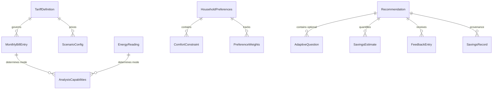

# Data Contracts & Analysis Mode Architecture
## HearthShift AI — Core Entities, Relationships, and Capability Envelopes

**Document Status:** Approved Data Specification  
**Source Code Reference:** `src/types/contracts.ts`  
**Schema Implementation:** `src/lib/db.ts`  

---

## 1. Overview & Architectural Principles

HearthShift AI operates on strict data-contract boundaries designed to guarantee:
1. **Mathematical Reproducibility:** Every billing and savings calculation is driven by pure functions consuming typed immutable inputs.
2. **Privacy by Default:** Data types encapsulate private household behavioral boundaries that must not leak across process boundaries.
3. **Honest Capability Gating:** Analysis capabilities are statically and dynamically bound to the data resolution actually provided by the user.

---

## 2. Analysis Mode Capability Mapping

The system enforces a strict boundary matrix between available data inputs and analytical capabilities. **Under no circumstances may the application violate these capability gates.**

| Analytical Feature | `basic` Mode (Monthly Bills) | `detailed` Mode (Interval CSV) | `realtime` Mode (Live Stream - v2) |
| :--- | :---: | :---: | :---: |
| **Historical Expenditure Tracking** | ✅ | ✅ | ✅ |
| **Tariff Slab / Tier Threshold Warning** | ✅ (Monthly aggregate) | ✅ (Continuous tracking) | ✅ (Live projection) |
| **Fixed Cost & Duty Calculation** | ✅ | ✅ | ✅ |
| **Parasitic Standby Estimation** | ⚠️ Heuristic boundary only | ✅ Minimum night-load baselining | ✅ Real-time steady state |
| **Time-of-Use (TOU) Rate Arbitrage** | ❌ **FORBIDDEN** | ✅ Empirical interval summing | ✅ Real-time schedule trigger |
| **Load Shifting Evaluation** | ❌ **FORBIDDEN** | ✅ Quantified cycle shifting | ✅ Dynamic automated alerts |
| **Appliance Disaggregation (NILM)** | ❌ **STRICTLY FORBIDDEN** | ⚠️ Bounded cycle signature | ⚠️ Real-time event matching |
| **Counterfactual Schedule Simulation** | ❌ Restricted to duration/off | ✅ Full temporal shifting | ✅ Full temporal shifting |

```
┌────────────────────────────────────────────────────────┐
│                   Data Resolution                      │
│                                                        │
│  [ Monthly Bill ] ──► Basic Mode                       │
│                        │                               │
│                        ├─► Slab/Tier Headroom Tracking │
│                        ├─► Standby Heuristics          │
│                        └─► ❌ NO Hourly Load Shifting  │
│                                                        │
│  [ Interval CSV ] ──► Detailed Mode                    │
│   (15m / 30m / 1h)     │                               │
│                        ├─► TOU Peak Arbitrage          │
│                        ├─► Empirical Baselining        │
│                        └─► Conservative Lower Bounds   │
└────────────────────────────────────────────────────────┘
```

---

## 3. Entity Relationships & Data Flow



### 3.1 Data Flow Lifecycle
1. **Ingestion:** User enters historical bills or drops a smart meter CSV. The `AnalysisCapabilities` detector evaluates resolution and sets `AnalysisMode`.
2. **Tariff Application:** The deterministic tariff engine applies the active versioned `TariffDefinition` (e.g., TANGEDCO LT-1A 2024).
3. **Opportunity Discovery:** The optimizer searches for load-shifting or consumption reduction actions $a \in \mathcal{A}$.
4. **Uncertainty & EVSI Evaluation:** The candidate action's lower credible bound $S_{\text{lower}}$ is computed. If uncertain, candidate `AdaptiveQuestion` objects are evaluated for $\text{EVSI}(q) - \alpha B(q) - \beta P(q)$.
5. **Decision Tri-State:**
   * High evidence $\rightarrow$ `Recommend`
   * High information gain $\rightarrow$ `Ask One Question`
   * Low benefit or intrusive $\rightarrow$ `Abstain / Stay Silent`
6. **Sparse Feedback:** User selects `Useful`, `Impractical`, or `Tried it`. Posterior weights update in local IndexedDB.
7. **Savings Provenance:** Follow-up bills verify whether savings transition from `simulated` to `user_reported` or `measured`.

---

## 4. Key Data Structures & Invariants

### 4.1 Deterministic Tariff Contracts (`TariffDefinition`)
* **Invariance:** A tariff definition is strictly versioned with an `effective_date`. When computing a bill spanning tariff transition dates, the calculation must prorate across active versions.
* **Telescopic vs Non-Telescopic Slabs:** In a telescopic tariff (e.g., standard residential), the first 100 units remain at Slab 1 rates even if total usage is 400 units. In a non-telescopic tariff, crossing 500 units shifts the entire bill to a punitive rate schedule. The `is_telescopic` boolean flags this critical distinction.

### 4.2 Savings Estimate & Provenance (`SavingsEstimate`)
* `point_estimate`: Expected mean savings ($\mathbb{E}[S]$).
* `lower_bound`: Conservative credible bound ($Q_\alpha(S)$, $\alpha = 0.05$). This is the primary figure shown to the user to prevent inflated expectations.
* `upper_bound`: Optimistic bound ($Q_{1-\alpha}(S)$).
* `basis`: Categorized as `simulated`, `user_reported`, or `measured`. Any UI presentation must visually distinguish these three states.

### 4.3 Adaptive Question Gating (`AdaptiveQuestion`)
* `evsi_score`: Calculated potential reduction in expected decision loss.
* `burden_score`: Cognitive friction index $[0, 1]$.
* `privacy_score`: Privacy intrusion index $[0, 1]$.
* `net_value`: Evaluated as $\text{EVSI} - \alpha \cdot \text{burden} - \beta \cdot \text{privacy}$. If this value is non-positive or below the hurdle rate, the question is discarded.