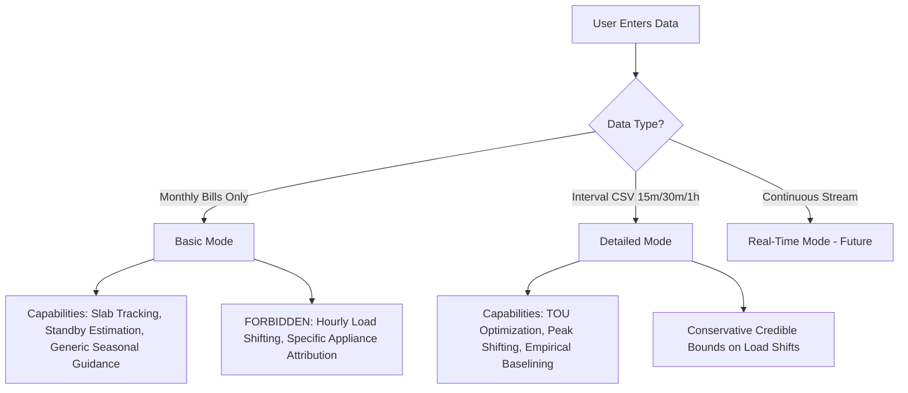

# Product Requirements Document (PRD)
## Project: HearthShift AI
### Privacy-First Home Energy Intelligence · Decision-Aware, Privacy-Minimal Assistant

**Document Status:** Under Architectural Review  
**Date:** November 22, 2026  
**Target Release:** v0.1.0 (MVP)  
**Author:** Principal Software Architect & Applied ML Researcher  

---

## 1. Executive Summary

HearthShift AI is a privacy-first, on-device household electricity decision assistant designed to help families reduce electricity costs without requiring exhaustive behavioral surveillance or continuous micro-surveys.

Traditional smart home solutions (e.g., Sense, Emporia Energy) and recent academic models (e.g., LICA 2026, edge-based privacy-preserving recommendation systems) focus on predicting consumption, disaggregating loads (NILM), or executing multi-step active questioning. Simply combining AI + smart meter + privacy + energy recommendations is **not** novel. 

HearthShift addresses a narrower, first-principles research problem:
> **"What is the smallest amount of information necessary to help a household make a verifiable, better electricity decision without disturbing their daily life or compromising private behavioral habits?"**

HearthShift introduces **SPARE-HEM** (*Sparse-feedback, Privacy-Aware, Risk-sensitive Energy Management*), an on-device decision architecture powered by:
1. **Value-of-Information (EVSI) Question Selection:** The system only poses queries to the user when the expected economic value of the answer exceeds the cognitive burden and privacy sensitivity of the question.
2. **Conservative, Evidence-Bounded Recommendations:** Recommendations are framed around lower credible bounds ($Q_\alpha(S)$) rather than noisy point estimates, distinguishing between simulated opportunities, user-reported trials, and meter-verified savings.
3. **Strict Progressive Data Resolution:** When only monthly utility totals are entered, the system remains strictly in basic mode and categorically refuses to invent synthetic hourly curves or appliance-specific attribution.

---

## 2. Problem Statement & First-Principles Analysis

### 2.1 The 5 Whys Root-Cause Investigation
1. **Why don't households reduce electricity costs?**  
   They lack actionable, trustworthy, context-specific guidance on what changes actually matter.
2. **Why isn't existing guidance useful?**  
   It is either generic ("turn off lights") or disconnected from the household's actual billing tariff and daily lifestyle constraints.
3. **Why isn't it personalized?**  
   Personalization historically requires high-frequency telemetry, appliance sensors, or repeated micro-surveys.
4. **Why is that difficult?**  
   High-frequency behavioral telemetry creates acute privacy and surveillance concerns (inferring sleep patterns, occupancy, cooking habits), and user fatigue causes high attrition.
5. **Why don't we solve it with more sensors?**  
   Hardware sensors cost money, are difficult to retrofit, break, and intensify privacy risks.

### 2.2 The Five Fundamental Truths of Domestic Energy Management
1. **Physical Actuation:** Electricity is consumed by physical devices governed by thermodynamics and appliance cycles, not AI models.
2. **Elasticity Dichotomy:** Some electrical usage is flexible (e.g., washing machine, thermal pre-cooling, water heating buffer), while other usage is inflexible and essential (medical equipment, refrigeration, evening task lighting).
3. **Inconvenience Cost:** A mathematically optimal schedule that saves ₹15 but interrupts sleep or delays breakfast will be rejected immediately. Inconvenience has a real subjective cost.
4. **Information Asymmetry & Diminishing Returns:** Collecting 95% more personal behavioral telemetry does not produce 95% better recommendations; often 1–2 critical routine constraints unlock 80% of actionable load shifting.
5. **Actionability Over Dashboarding:** An attractive visualization is useless if the household cannot or will not act on the recommendation.

---

## 3. User Personas

### Persona A: Primary — The Working Family in Chennai (Sundaram Family)
* **Demographics:** 4-person family (parents + 2 school-age children) in a 3BHK flat in T. Nagar, Chennai.
* **Appliance Inventory:** 3 ceiling fans, 2 split AC units (1.5 ton inverter), 1 front-load washing machine (1.5 kWh cycle), 1 frost-free refrigerator (260L), LED lighting, induction stove.
* **Tariff Structure:** TANGEDCO LT-1A bi-monthly domestic tariff (slab-based tiered tariff with subsidized tiers and higher marginal rates for consumption > 500 kWh).
* **Pain Points:** Summer bimonthly bills spike above 800 units, placing them in penalizing tariff slabs. They don't know whether adjusting the AC setpoint from 22°C to 25°C or shifting laundry to the morning will meaningfully reduce their tier. They work busy hours and will uninstall any app that asks 5 questions daily.

### Persona B: Secondary — The Privacy-Minded Tech Professional
* **Demographics:** Remote software engineer in Bengaluru with rooftop solar and smart meter CSV export.
* **Pain Points:** Wants to align high-draw loads (dishwasher, EV trickle charge) with solar generation/time-of-day tariffs. Adamantly refuses cloud sync of granular smart-meter logs or behavioral telemetry.

### Persona C: Tertiary — The Fixed-Income Retired Couple
* **Demographics:** Senior citizens living on a pension in Coimbatore.
* **Appliance Inventory:** Modest appliances, standard fan and lighting usage, water pump.
* **Pain Points:** Enters paper electricity bills manually every 2 months. Needs simple, highly accessible recommendations in Tamil (தமிழ்) with zero technical jargon.

---

## 4. Competitive Analysis & Research Differentiation

| Feature / Dimension | Sense | Emporia Energy | LICA (2026) | Nov 2026 Edge Study | HearthShift AI (Proposed) |
| :--- | :--- | :--- | :--- | :--- | :--- |
| **Primary Architecture** | Cloud-tethered high-frequency NILM | Cloud + physical smart plugs / monitor | Adaptive questioning + scheduling | Edge-based privacy-preserving recs | Local-first PWA / WebAssembly / Web Workers |
| **Hardware Required** | Yes (Dedicated panel monitor) | Yes (Vue monitor / smart plugs) | Simulated / theoretical | Simulated edge nodes | **No (Bill entry or CSV import)** |
| **Privacy Boundary** | Raw data uploaded to cloud | Cloud backend storage | Research model | Federated learning / edge cluster | **100% on-device by default (IndexedDB)** |
| **Questioning Strategy** | Passive (no questioning) | Static threshold notifications | Adaptive questioning | Static preference profiles | **Decision-Theoretic EVSI (Cost vs Burden vs Privacy)** |
| **Savings Estimates** | Point estimates | Real-time watt-hour tracking | Optimization objective | Utility curves | **Conservative Credible Bounds ($Q_\alpha(S)$) + Basis Tracking** |
| **Tariff Engine** | Generalized average rates | Configurable TOU | Mathematical formulation | Synthetic tariff | **Deterministic, Versioned Regional Rules (TANGEDCO, etc.)** |
| **Low-Data Fallback** | Fails without high-res monitor | Fails without smart monitor | Assumes interval data | Assumes interval data | **Graceful basic mode (explicit capability gating)** |

### Honest Novelty Boundary
* Combining AI, smart meters, privacy, and recommendation generation is **established prior art**.
* HearthShift’s narrow research candidate contribution:
  1. Integrating Expected Value of Sample Information ($\text{EVSI}$) with explicit penalties for cognitive burden and privacy sensitivity ($q^* = \arg\max [\text{EVSI}(q) - \alpha B(q) - \beta P(q)]$) in residential demand management.
  2. A conservative three-outcome decision policy: `Recommend` (evidence-bounded savings > threshold), `Ask Question` (net value > hurdle), or `Abstain / Stay Silent` (insufficient evidence or sub-threshold benefit).
  3. Evidence basis provenance tracking: Categorizing savings explicitly into `simulated`, `user_reported`, and `measured`.

---

## 5. Functional Requirements

### FR-001: Manual Bill Entry
* **Priority:** Must Have (Phase 1)
* **Description:** User can enter historical electricity bills: start date, end date, total consumption in kWh (units), total bill amount in local currency, and tariff scheme.
* **Acceptance Criteria:** Validates dates (no future dates, end > start), validates non-negative units, persists to IndexedDB, calculates calculated vs billed delta if tariff is selected.

### FR-002: Local Smart-Meter CSV Importer
* **Priority:** Must Have (Phase 1)
* **Description:** In-browser parsing of interval smart-meter data (half-hourly, hourly, 15-minute).
* **Acceptance Criteria:** Parses Low Carbon London, REFIT, and standard 2-column CSV formats (`timestamp, kwh`). All processing in browser memory/Web Worker. Zero network calls. Rejects malformed rows with line-by-line feedback.

### FR-003: Versioned Regional Tariff Engine
* **Priority:** Must Have (Phase 1)
* **Description:** Deterministic calculation engine supporting flat, tiered (slab), Time-of-Use (TOU), and hybrid tiered-TOU tariffs with fixed charges, duty, and effective date versioning.
* **Acceptance Criteria:** Tested against verified TANGEDCO LT-1A tariff schedules; produces exact Rupee-for-Rupee matches for edge cases (slab boundaries: 100, 200, 400, 500, 600, 800 kWh).

### FR-004: Analysis Mode & Capability Gating
* **Priority:** Must Have (Phase 1)
* **Description:** Explicit determination of whether the system operates in `basic` (monthly bill data only) or `detailed` (interval time-series) mode.
* **Acceptance Criteria:** In `basic` mode, the UI disables hourly load-shifting graphs and appliance-level attribution, presenting only tier management and standby conservation heuristics.

### FR-005: Scenario Simulator (What-If Sandbox)
* **Priority:** Should Have (Phase 2/3)
* **Description:** Interactive simulation allowing the user to test what happens if an appliance cycle is shifted, AC setpoint is adjusted, or standby power is eliminated.
* **Acceptance Criteria:** Calculates counterfactual bill under baseline vs proposed schedule, showing bill difference, tariff tier changes, and estimated comfort impact.

### FR-006: On-Device Bayesian Preference Model
* **Priority:** Should Have (Phase 2)
* **Description:** Representation of household inconvenience parameter $\theta \sim \mathcal{N}(\mu, \Sigma)$ updated via sparse user feedback ("Useful", "Impractical", "Tried it").
* **Acceptance Criteria:** Posterior distribution updates in browser via closed-form or Laplace approximation without remote API calls.

### FR-007: Decision-Aware Question Selection Engine (EVSI)
* **Priority:** Research Flagship / Should Have (Phase 2)
* **Description:** Selection of candidate questions that maximize net value: $\text{EVSI}(q) - \alpha B(q) - \beta P(q)$.
* **Acceptance Criteria:** If no candidate question has net positive value, the system remains silent and outputs zero questions.

### FR-008: Conservative Recommendation Policy
* **Priority:** Must Have (Phase 2/3)
* **Description:** Tri-state decision engine: `recommend`, `ask_question`, or `abstain`.
* **Acceptance Criteria:** Recommends only when the lower credible bound $Q_\alpha(S) > S_{\min}$. Displays point estimate alongside lower bound and explicit list of assumptions.

### FR-009: User Feedback Collection
* **Priority:** Must Have (Phase 3)
* **Description:** Simple 1-click feedback options for each recommendation: `Useful`, `Not practical for our routine`, and `Tried it`.
* **Acceptance Criteria:** Immediately updates preference weights in IndexedDB and re-evaluates active recommendations.

### FR-010: Savings Evidence Provenance Tracker
* **Priority:** Must Have (Phase 3)
* **Description:** Visual badge and ledger distinguishing savings basis:
  * 🟡 `Simulated Opportunity` (counterfactual model prediction)
  * 🔵 `User Reported` (household confirmed adoption)
  * 🟢 `Meter Verified` (subsequent bill or interval readings confirm consumption reduction)
* **Acceptance Criteria:** Clear separation in user UI; never claim verified savings based solely on simulation.

### FR-011: Multilingual Localization Foundation (English & Tamil)
* **Priority:** Must Have (Phase 1/3)
* **Description:** Native internationalization (i18n) supporting English and Tamil (தமிழ்), including localized numbers, currency (₹), and energy terms.
* **Acceptance Criteria:** Complete translation of Phase 1 UI; zero untranslated key fallback errors on core workflows.

### FR-012: Progressive Web App (PWA) Offline Operation
* **Priority:** Must Have (Phase 1/4)
* **Description:** Service Worker caching of app bundle, offline execution, and local persistence.
* **Acceptance Criteria:** App loads, calculates bills, runs scenario simulations, and manages data completely offline after initial install.

---

## 6. Non-Functional Requirements (NFR)

* **NFR-001 (Zero Telemetry Privacy):** Zero transmission of raw interval energy readings or user schedule answers to external servers. Verified via automated network interception tests in Playwright.
* **NFR-002 (Local Performance):** Billing calculation for 8,760 hourly points must complete in $< 150\text{ ms}$ on a mid-tier mobile processor. EVSI evaluation must complete in $< 1.5\text{ s}$.
* **NFR-003 (Deterministic Correctness):** Tariff and billing calculations must be 100% deterministic with zero floating-point drift beyond IEEE 754 epsilon.
* **NFR-004 (Accessibility):** Full adherence to WCAG 2.1 Level AA standards, including high-contrast color palettes (minimum 4.5:1 ratio), screen-reader labels, and keyboard navigability.
* **NFR-005 (Data Sovereignty):** 1-click `Export All Data` (formatted JSON) and 1-click `Permanent Data Erasure` (IndexedDB drop + cache purge).

---

## 7. Data Input Modes & Analysis Boundaries

| Dimension | Basic Analysis Mode (Monthly Bills) | Detailed Analysis Mode (Smart Meter CSV) | Real-Time Mode (v2 Future) |
| :--- | :--- | :--- | :--- |
| **Minimum Input** | Bimonthly or monthly kWh | Interval readings ($\le 1\text{ hr}$ resolution) | Continuous telemetry stream |
| **Hourly Curve Inference** | ❌ **Strictly Forbidden** | ✅ Empirical calculation | ✅ Live sliding window |
| **Appliance Disaggregation** | ❌ **Forbidden** | ⚠️ Bounded heuristics only | ⚠️ Event-based signatures |
| **Load Shifting Recommendations** | ❌ None (shifting requires TOU/hourly data) | ✅ Quantified shifting between rate windows | ✅ Automated/prompt alerts |
| **Tariff Slab Optimization** | ✅ "Units to next slab boundary" | ✅ Exact slab + time-of-day cost | ✅ Real-time cost trajectory |

---

## 8. Success Metrics & Validation Targets

1. **Question Reduction:** $\ge 30\%$ fewer questions asked compared to a fixed sequential questionnaire baseline.
2. **Decision Value Preservation:** $\le 5\%$ economic decision loss compared to an idealized full-information oracle.
3. **Privacy Compliance:** Exactly $0$ bytes of raw household energy data transmitted outside the client browser.
4. **Statistical Calibration:** Nominal 95% credible intervals for savings achieve between $92\%$ and $98\%$ empirical coverage under synthetic testing.
5. **Cold-Start Acceptability:** First actionable, non-trivial recommendation delivered within $\le 2$ interactions.

---

## 9. Scope Boundaries (What HearthShift Is NOT)

* **No Automated Appliance Actuation:** HearthShift will not switch off relays, control smart plugs, or adjust smart thermostats directly in v1. It is a human-in-the-loop decision assistant.
* **No Speculative Appliance Disaggregation:** We do not claim to solve unsupervised non-intrusive load monitoring (NILM) from noisy aggregated data.
* **No Remote LLM Dependency for Calculations:** No billing arithmetic, cost optimizations, or EVSI calculations will be delegated to language model APIs. All math is deterministic, verified code.
* **No Fabricated Savings:** If an action saves 50 paise a month, the app will explicitly report 50 paise or choose to remain silent. It will never inflate numbers to look impressive.

---

## 10. Glossary of Terms

* **SPARE-HEM:** Sparse-feedback, Privacy-Aware, Risk-sensitive Energy Management algorithm.
* **EVSI:** Expected Value of Sample Information — decision-theoretic metric quantifying how much expected loss is reduced by obtaining a specific piece of noisy information.
* **TOU (Time-of-Use):** Electricity tariff pricing that varies depending on the hour of the day (e.g., peak, normal, off-peak).
* **Tiered / Slab Tariff:** Pricing structure where per-unit cost increases as total billing-period consumption crosses set thresholds (e.g., TANGEDCO 0-100 free, 101-200 ₹2.25, 201-500 ₹4.50, >500 ₹6.00).
* **Load Shifting:** Moving a flexible electrical task from a higher-price or higher-carbon time window to a lower-price window without reducing the total electrical energy consumed.
* **Consumption Reduction:** Eliminating wasteful electrical energy entirely (e.g., adjusting air conditioner setpoint, eliminating parasitic standby power).
* **Credible Lower Bound ($Q_\alpha$):** The $\alpha$-quantile of the posterior savings distribution, used as a conservative floor for decision gating.